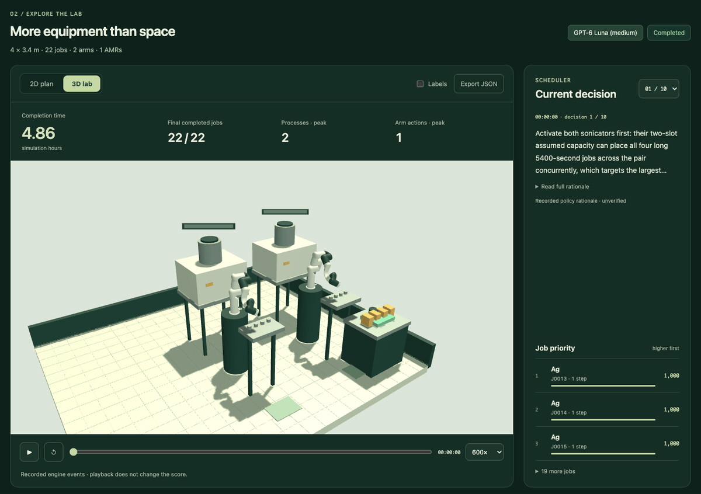

# LabOpsBench

**A simulation-based benchmark for equipment configuration and experiment scheduling by AI agents and algorithms.**

Ryoma Yamamoto · Haruki Nakajima

LabOpsBench asks a policy to select equipment configurations and prioritize predefined experimental jobs under room, equipment, robot-arm and transport constraints. The simulator executes those decisions, accounts for contention and permitted equipment moves, and measures the time until the complete workload finishes.



A recorded benchmark run in the results viewer: GPT-6 Luna (medium) on scenario 12, *More equipment than space* (4 × 3.4 m room, 22 jobs, two active bays for 36 owned instruments). The 4.86-hour run plays as a time-lapse. The active equipment is exchanged twice as the scheduler's decisions take effect. Frames are captured from the saved engine result ([capture record](docs/assets/labopsbench-replay.json), `scripts/capture-readme-replay.mjs`).

[Demo video](https://www.youtube.com/watch?v=tVD-mtF-0fY) · [One-page summary](docs/submission-2026/LabOpsBench-one-page-summary-latex.pdf) · [Evaluation protocol](docs/LEMAT_SDL_BENCHMARK.md) · [Recorded results](docs/LEMAT_SDL_RESULTS.md) · [Agent interface](docs/SCHEDULER_INTERFACE.md)

## Try the recorded benchmark

Requires Node.js 18.16 or later. No Python, npm installation, API key or new model inference is needed.

```sh
git clone https://github.com/Luftalian/labops-bench.git
cd labops-bench
npm run view:results
# Open http://127.0.0.1:4181/
```

Select a completion time in the scenario-by-policy table, inspect the 2D/3D laboratory replay, and follow the recorded scheduling decisions. Scores are read from saved engine results.

The distribution contains **16 scenarios and 80 selected trials**: five methods on every scenario.
- Methods: arrival-order FIFO, capacity + longest remaining work, bottleneck/travel + downstream-first, GPT-6 Luna (medium), and Jev 1.14.0.
- Fourteen scenarios derive from public LeMat-Synth annotations; two are synthetic scheduler tasks in 8×7 m and 14×10 m rooms.
- Scenarios 11–14 keep the runs quoted in the paper; the other 60 trials are fresh runs under the same task and configuration hashes ([selection and validation](docs/LEMAT_SDL_BENCHMARK.md)).

The challenges include scarce equipment, future arrivals, finite buffers, transport contention, equipment exchanges, and dense layouts. These are exploratory, single-trial comparisons within declared candidate spaces. They do not establish a general ranking of models.

## What the policy decides

| At a decision point | Information or responsibility |
| --- | --- |
| Input | Remaining jobs and operation dependencies, known future arrivals, processing times, equipment capabilities, room and resource limits, current layout and resource state |
| Output | An initial configuration or permitted equipment exchange from the shared candidate menu, plus job priorities |
| Timing | Initial decision at simulation time zero, then every 1,800 simulation seconds in the published suite, with at most 32 decisions |
| Engine | Validates the decision, dispatches feasible operations, manages arms, mobile robots, buffers and reservations, and advances simulation time |
| Score | Makespan through the final operation and arm unloading of every job; incomplete runs receive no finite completion score |

The simulation clock pauses while a policy responds. Model latency and cost are separate from simulated makespan. The canonical interface also supports explicit layouts; the published comparison evaluates shared finite configuration candidates. See [comparison scope](docs/SCHEDULER_CHALLENGES.md).

The LeMat-derived workflows come from three public LeMat-Synth annotation records, normalized into eight scheduling templates. Equipment mappings and missing durations contain documented assumptions. LabOpsBench evaluates scheduling in simulation; it does not generate new scientific hypotheses or predict reaction success.

## Run the simulator or evaluate a policy

Requires Python 3.11+ and Node.js 18.16+.

```sh
python3 -m venv .venv
.venv/bin/python -m pip install -r requirements-lock.txt
npm start
```

Open [the benchmark viewer](http://127.0.0.1:4173/benchmarks/) or [the scheduler](http://127.0.0.1:4173/scheduler/). The root page contains the separate fixed-design v0.2 evaluator; historical modes remain available for compatibility. [Specification](SPEC.md) explains the modes.

A new heuristic evaluation runs locally:

```sh
node scripts/run-lemat-sdl.mjs
```

For custom algorithms or model providers, follow the [agent interface and evaluation procedure](docs/SCHEDULER_INTERFACE.md). Model runners require a separately configured provider or contestant process; starting the viewer or simulator never starts model inference.

## Reproducibility

```sh
python3 docs/submission-2026/verify_evidence.py
npm run check
npm run check:import
npm run check:poc
npm run check:poc:replay
```

The first command uses the Python standard library to verify all 80 distributed recordings, the paper's quoted values, source annotations and manuscript assets. The other checks use the environment installed above. Recorded replay and fresh inference are different operations.

- [Paper, editable LaTeX, citations and numerical evidence](docs/submission-2026/README.md)
- [Task settings, model identities and reproduction commands](docs/LEMAT_SDL_BENCHMARK.md)
- [Sources and modeling assumptions](docs/SOURCES.md)
- [Submission video sources and build instructions](docs/SUBMISSION_VIDEO.md)
- [Third-party notices](THIRD_PARTY_NOTICES.md)

## Citation and licensing

Use [CITATION.cff](CITATION.cff) for the project authors and repository URL. LabOpsBench's original code and associated documentation are licensed under the [MIT License](LICENSE). Bundled third-party code, data and assets retain their own licenses and notices in [licenses/](licenses/README.md) and [THIRD_PARTY_NOTICES.md](THIRD_PARTY_NOTICES.md).

This public repository retains the authors and timestamps of the included development commits. Internal planning documents, research working notes and superseded submission drafts were excluded from its history.
