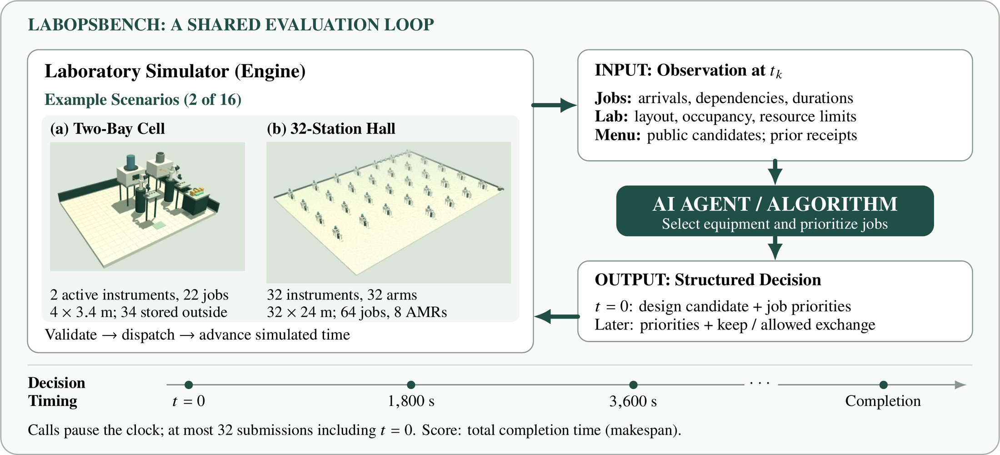

# LabOpsBench: Benchmarking AI Agents for Laboratory Configuration and Experiment Scheduling

We built LabOpsBench, a simulation-based benchmark for evaluating how AI agents select laboratory equipment configurations and prioritize predefined experimental jobs under shared resource constraints. Across 16 scenarios and 80 selected completed trials, our pilot shows that the relative performance of language-model agents and conventional scheduling methods depends on the scenario.

**Motivation.** Self-driving laboratories (SDLs) automate experiments and use their results to choose what to test next ([Tom et al., 2024](https://doi.org/10.1021/acs.chemrev.4c00055)). Language-model agents also execute robotic experiments, as demonstrated by [Coscientist](https://doi.org/10.1038/s41586-023-06792-0) and [ACRA](https://doi.org/10.1038/s42004-026-01993-w). Efforts to build and scale SDL infrastructure include Canada's [Acceleration Consortium](https://acceleration.utoronto.ca/news/u-of-t-receives-200-million-grant-to-support-acceleration-consortiums-self-driving-labs-research) and autonomous-laboratory initiatives under the US [Genesis Mission](https://www.cmu.edu/news/stories/archives/2026/july/connecting-autonomous-laboratories-to-speed-scientific-advancement) and Japan's [ARiSE programme](https://www.jst.go.jp/program/arise/pdf/arise_siryo_st.pdf#page=8). [Cloud laboratories](https://doi.org/10.1002/admt.202400084) offer remote access to shared instruments, but scheduling requires coordinating [workflow dependencies and instrument capacity](https://doi.org/10.1039/D6SC03892A), transport, and space. These constraints motivate evaluating agents' configuration and scheduling decisions.

**Benchmark and evaluation.** LabOpsBench models instruments, robot arms, autonomous mobile robots (AMRs), queues, and finite buffers. Jobs comprise dependent operations with fixed durations and required capabilities. Scenarios range from small cells to a facility with 32 instruments, 32 arms, and 64 jobs. Fourteen scenarios use eight scheduling templates adapted from three [public annotation records](https://github.com/LeMaterial/lematerial-llm-synthesis/tree/e4bacbcbac084544ca68d48242336c2e36f6ee15/annotations) associated with [LeMat-Synth](https://arxiv.org/abs/2510.26824v2); two additional scenarios are synthetic. Equipment mappings and missing timings are modeling assumptions.

At $t=0$, each method receives the laboratory state, remaining jobs including future arrivals, and shared configuration candidates, then selects equipment/layout and job priorities. Subsequent decisions occur every 1,800 simulated seconds and update priorities or request permitted equipment exchanges. Model calls pause the simulation clock; after 32 submissions, the last valid policy continues. The engine validates decisions, dispatches feasible operations, and controls robot motion. Exchanges wait for admitted jobs to finish and incur handling, movement, reconnection, and calibration time. The score is total completion time (*makespan*), including final unloading; incomplete runs receive no finite completion score.

*Figure 1. LLM agents, heuristics, and algorithms share the same evaluation interface. Panels (a) and (b) show recorded replays of scenarios 12 and 03, two independent examples from the 16-scenario suite.*

**Findings.** We compared `gpt-6-luna` (medium reasoning) and `jev-1.14.0` with FIFO, a reference heuristic, and a workload-aware algorithm. The [recorded comparison](https://github.com/Luftalian/labops-bench/blob/d19ec428edd714b0ce52700b03a925d6604ed030/docs/LEMAT_SDL_RESULTS.md) includes all five methods on each scenario, with shared workloads, seeds, resource limits, and candidate-generation rules. Scenario 12 (36 owned instruments, two active bays, 22 jobs) yielded makespans of 4.860 h (Luna), 5.459 h (Jev), 5.068 h (algorithm), and 7.661 h (FIFO/reference). In the refreshed scenario 04 (staggered arrivals, 48 jobs), Jev required 109.892 h, versus 110.300 h (FIFO) and 112.793 h (Luna). Three Luna conditions were rerun after malformed answers, so cumulative inference attempts differ. These exploratory results do not establish general model rankings. Chemical outcomes and transfer to physical laboratories remain unvalidated.

LabOpsBench links structured decisions to simulated laboratory execution, enabling controlled comparisons of equipment configuration and scheduling strategies from compact cells to larger facilities.

*Ryoma Yamamoto, Haruki Nakajima · Team LabWeave*
